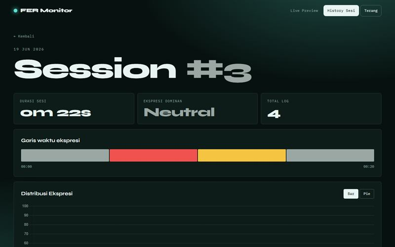

# FER Monitor

Pemantau ekspresi wajah dari webcam dengan MobileNetV2, MTCNN, dan Flask. Proyek kelompok.

**Demo:** https://portofolio-jauza-fawaid.netlify.app/DETEKSI-EKSPRESI/ (pratinjau statis dengan data contoh)



Aplikasi web pemantau ekspresi wajah secara langsung dari webcam. Dibuat bersama kelompok.

## Cara kerja

1. Webcam dibaca di thread terpisah supaya tayangan tetap lancar.
2. Wajah dicari dengan MTCNN pada frame yang diperkecil.
3. Tiap wajah diklasifikasikan oleh model Keras berbasis MobileNetV2 ke tujuh ekspresi.
4. Hasilnya dihaluskan dengan voting mayoritas dari beberapa deteksi terakhir.
5. Saat sesi berjalan, ekspresi dicatat tiap 5 detik ke CSV, ringkasannya ke SQLite.

## Fitur

- Tayangan langsung dengan kotak wajah dan tingkat keyakinan
- Warna halaman mengikuti ekspresi yang terbaca
- Rekam sesi, riwayat, saringan, dan statistik total
- Garis waktu ekspresi per sesi, grafik distribusi, unduh CSV
- Ganti sumber kamera tanpa memulai ulang aplikasi
- Halaman transparansi kinerja model

## Kinerja model

Diukur ulang dengan `evaluate.py` pada 7.066 gambar validasi:

| Ukuran | Nilai |
|---|---|
| Akurasi | 57,9% (tebakan acak 14,3%) |
| Macro F1 | 0,536 |
| Terkuat | happy F1 0,80, surprise F1 0,71 |
| Terlemah | fear F1 0,30, angry F1 0,46 |

Sebelum prapemrosesan disamakan dengan saat pelatihan (`preprocess.py`: abu-abu, 48 x 48, perbesar nearest), akurasi model ini pada gambar yang sama hanya 52,2%.

Data validasi ini juga dipakai untuk memilih model terbaik, jadi angka sebenarnya bisa sedikit lebih rendah. Pengukuran pada data uji terpisah masih perlu dilakukan. Ekspresi wajah tidak sama dengan perasaan seseorang, jadi model ini tidak cocok untuk keputusan tentang seseorang.

## Menjalankan

```bash
python -m venv venv
venv\Scripts\activate
pip install -r requirements.txt
python app.py
```

Buka http://127.0.0.1:5000. Aplikasi hanya melayani komputer sendiri, karena menampilkan webcam. Ubah `HOST` di `config.py` jika memang perlu diakses dari perangkat lain.

## Pengujian

```bash
python -m unittest discover -s tests -v
```

Pengujian berjalan tanpa webcam dan memakai basis data sementara. `python evaluate.py <folder_uji>` mengukur model pada folder gambar berstruktur `<ekspresi>/*.jpg`.

## Teknologi

Python, Flask, TensorFlow/Keras, OpenCV, MTCNN, SQLite, Chart.js
